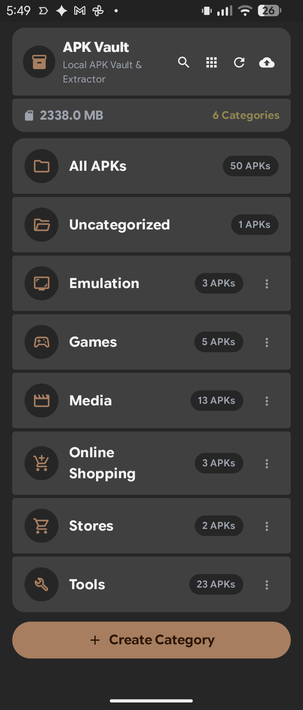
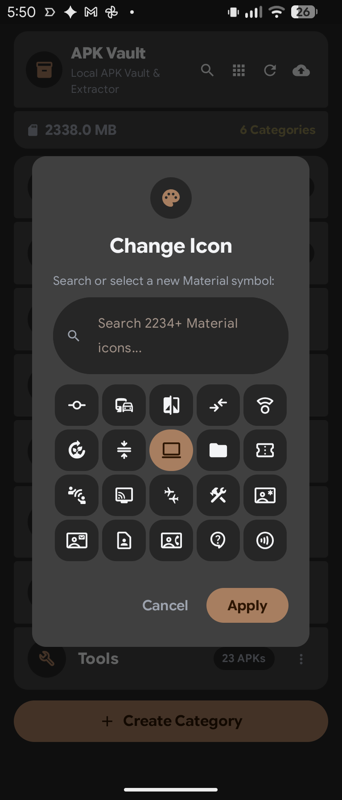
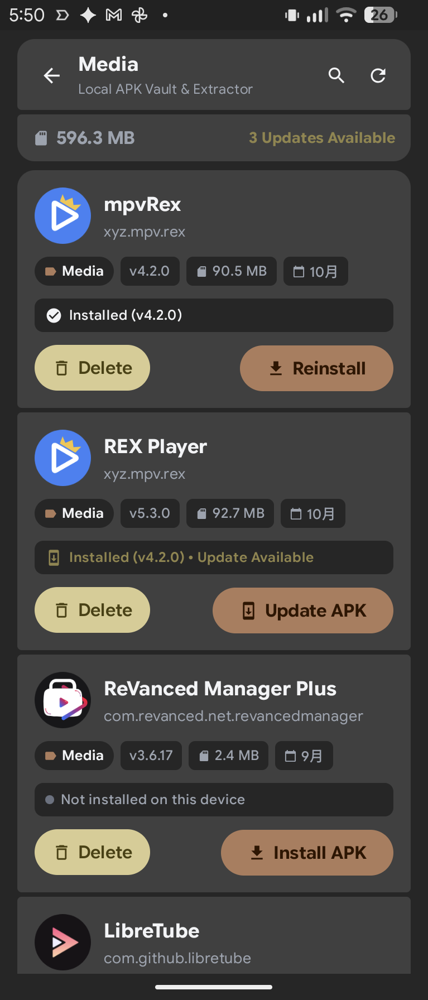

# 📱 Screenshots Showcase

Visual tour of **APK Vault** interfaces, theme compliance, and package management workflows.

---

### 🗂 Dashboard & Organization
*Overview of local storage, total package counts, and custom category grouping.*

 

---

### 🎨 Material Symbols Picker
*Dynamic search and local offline caching across 2,000+ official Google Material icons.*

 

---

### 🔍 Inspector & APK Actions
*Direct package installation, reassignment, and real-time Manifest parsing.*

 

 

---

[← Back to Main README](README.md)

